<div align="center">


# PFE Navigator

**A full-stack platform to manage the complete lifecycle of Final Year Projects (PFE)**
from topic selection to grade publication.

[](https://www.djangoproject.com)
[](https://www.django-rest-framework.org)
[](https://react.dev)
[](https://www.typescriptlang.org)
[](https://vitejs.dev)
[](https://www.postgresql.org)

</div>

---

## Table of Contents

1. [Overview](#overview)
2. [Screenshots](#screenshots)
3. [Features](#features)
4. [Tech Stack](#tech-stack)
5. [Architecture](#architecture)
6. [Data Model](#data-model)
7. [Business Flows](#business-flows)
8. [Project Structure](#project-structure)
9. [Getting Started](#getting-started)
10. [Configuration](#configuration)
11. [Authentication & Security](#authentication--security)
12. [API Reference](#api-reference)
13. [Critical Areas of the Codebase](#critical-areas-of-the-codebase)
14. [Author](#author)

---

## Overview

PFE Navigator centralizes and automates the management of final year projects at **EMSI**. It replaces spreadsheets, emails and paper forms with a single role-based web application.

```
Topic proposal  →  Student request  →  Follow-up & documents  →  Defense  →  Published grade
```

| Role | Responsibilities |
|------|------------------|
| **Administrator** | Validates topics and requests, assigns juries, publishes grades, monitors analytics |
| **Supervisor** | Proposes topics, follows students, reviews documents, evaluates |
| **Jury member** | Consults assigned projects and documents, scores the defense |
| **Student** | Chooses a topic, submits deliverables, tracks progress and results |

---

## Screenshots

> Images are stored in [`docs/screenshots/`](docs/screenshots). See the [naming guide](docs/screenshots/README.md) to add or replace them.

### Authentication

<p align="center">
  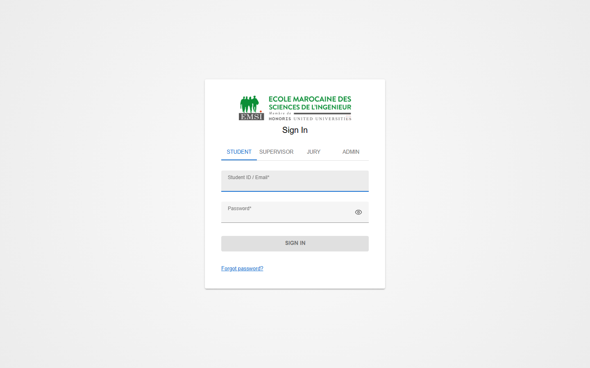
</p>

### Administrator

| Dashboard | Analytics |
|:---:|:---:|
| 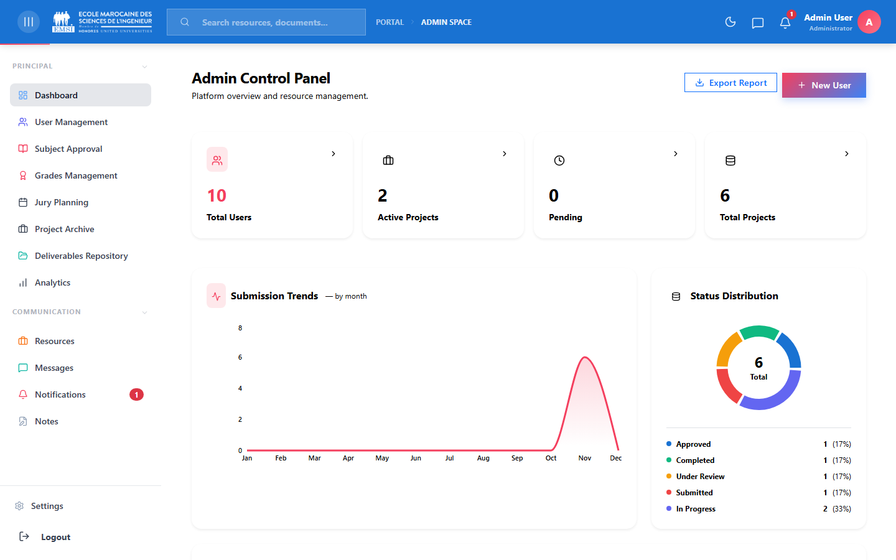 | 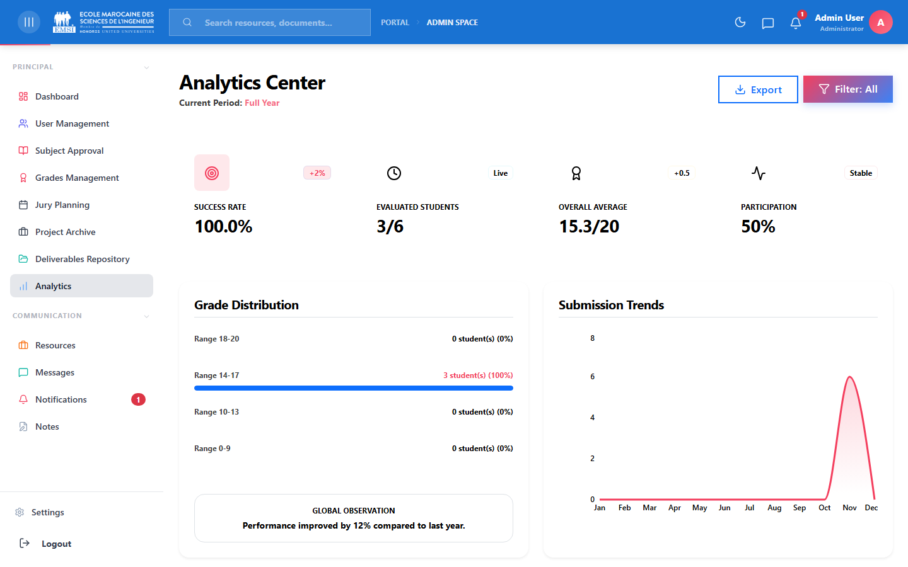 |

| Users management | Grades & publication |
|:---:|:---:|
| 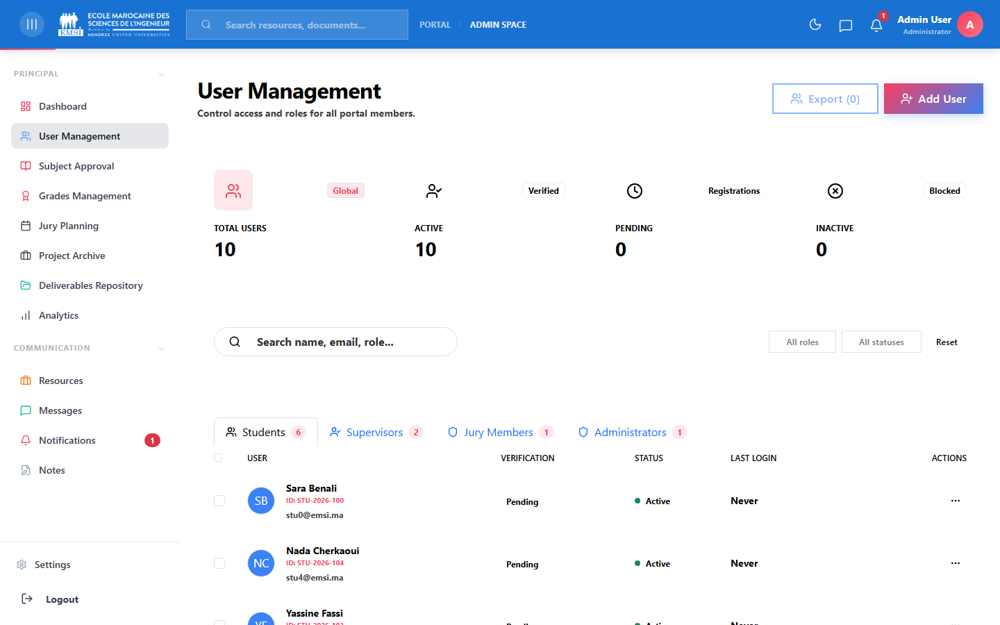 | 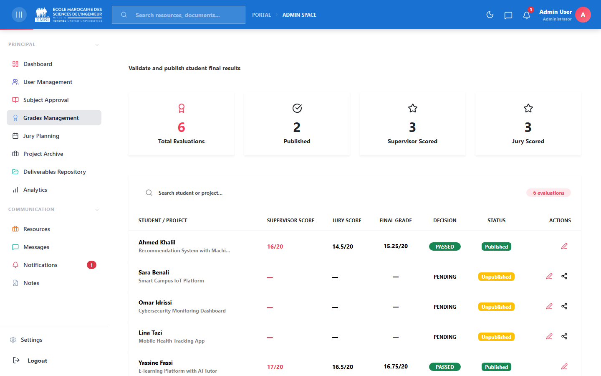 |

### Supervisor

| Dashboard | My students |
|:---:|:---:|
| 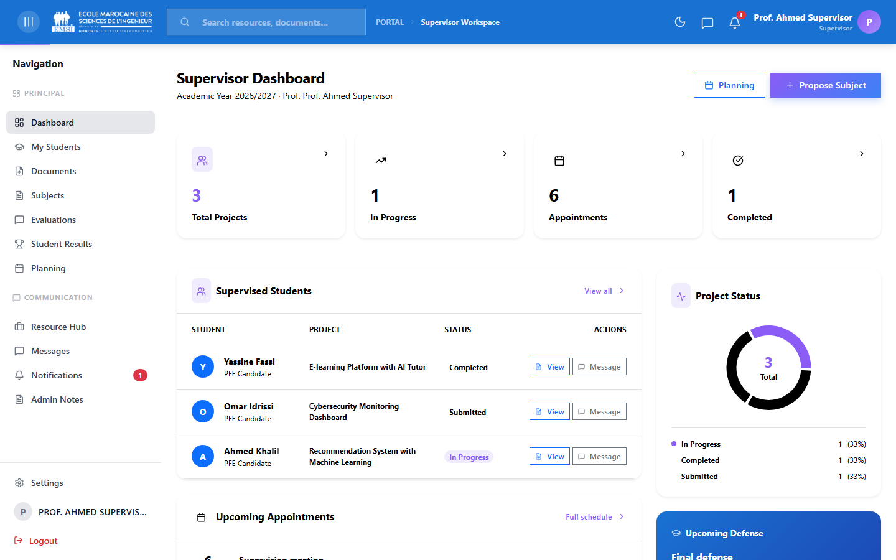 | 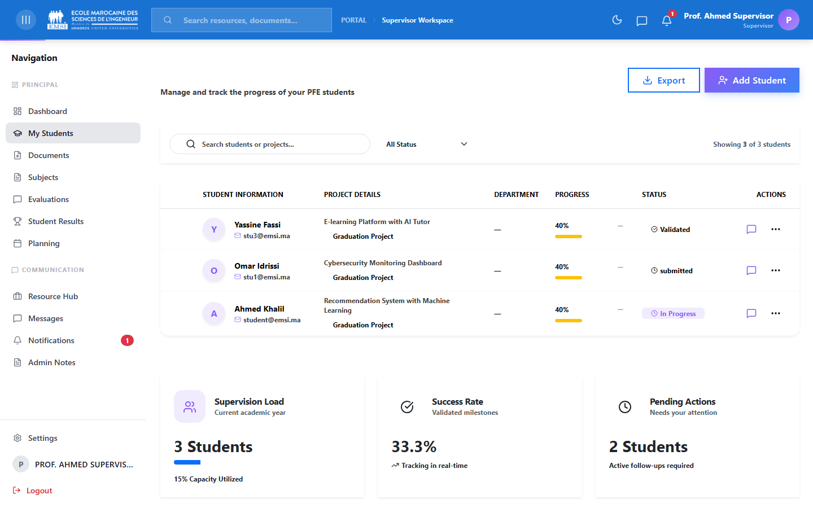 |

### Student

| Dashboard | Reports & documents |
|:---:|:---:|
| 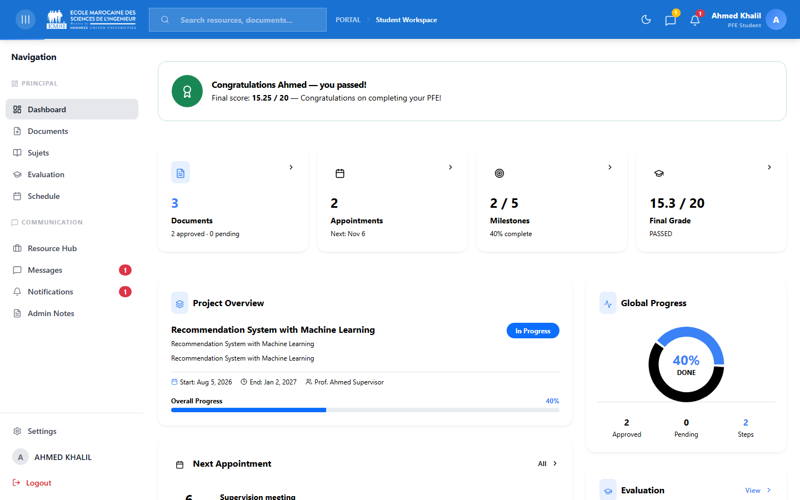 | 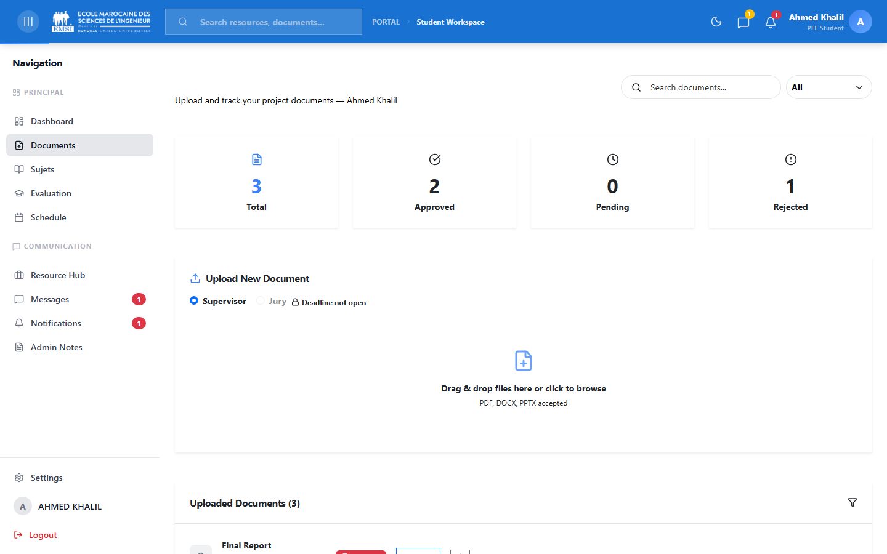 |

### Jury

| Projects | Defense evaluation |
|:---:|:---:|
| 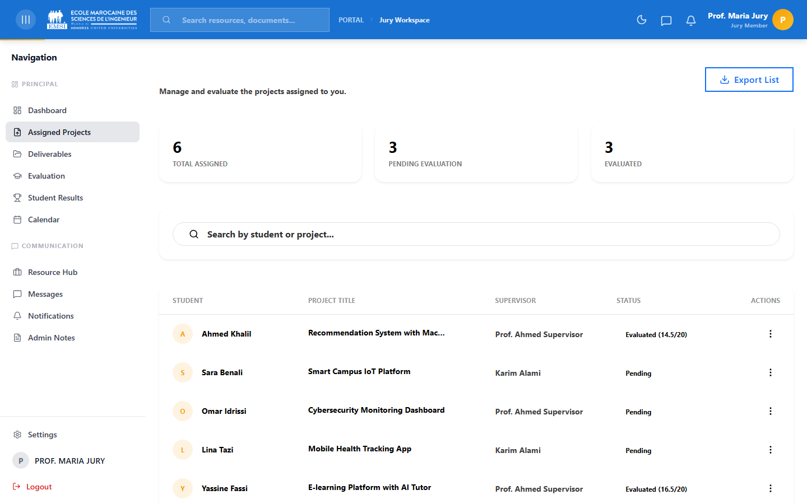 | 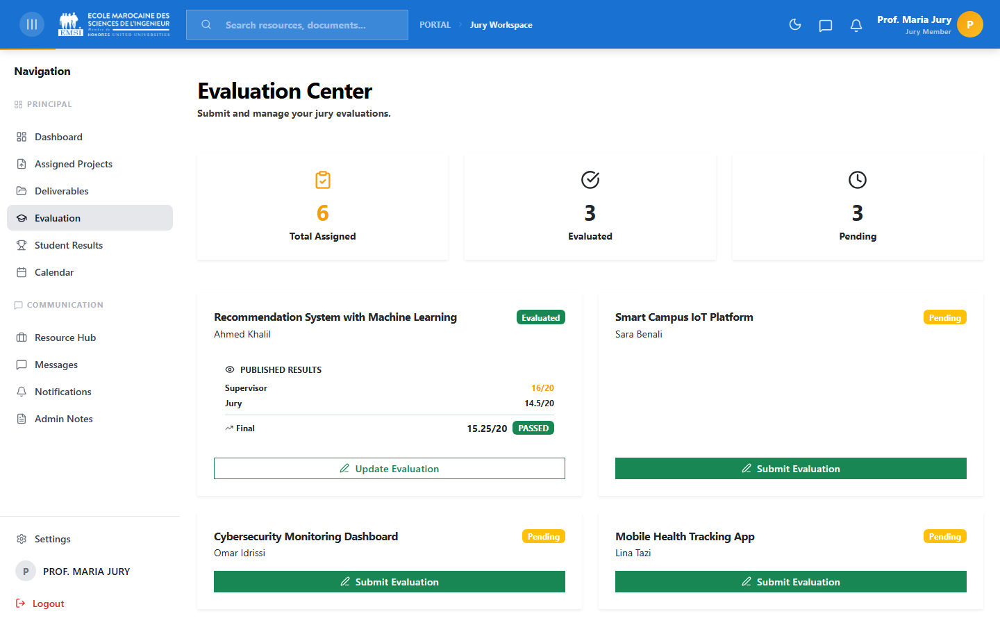 |

### Theming

<p align="center">
  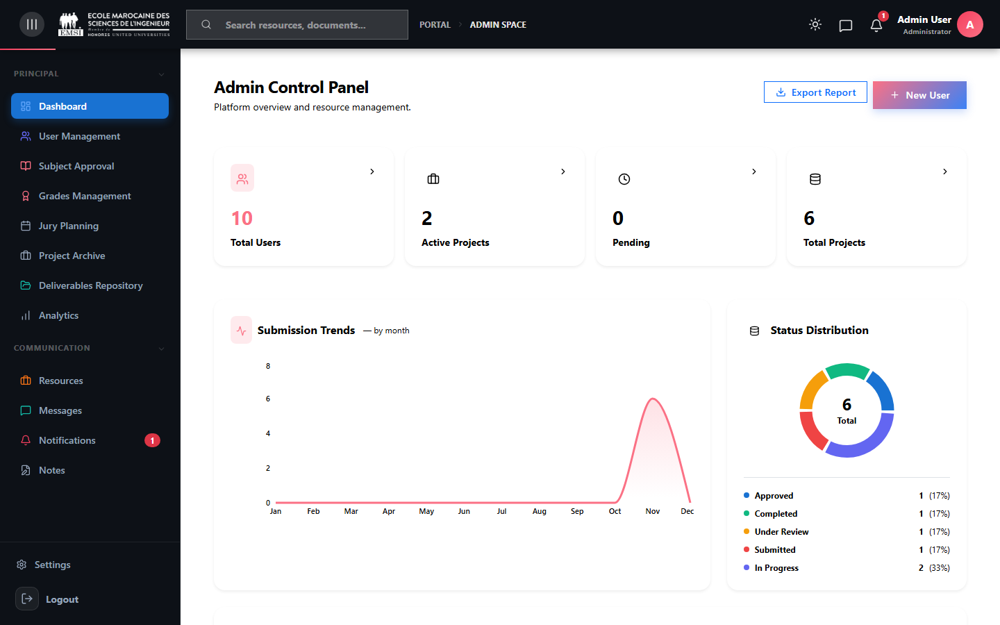
</p>

---

## Features

<details open>
<summary><b>Administrator</b></summary>

- Global dashboard with metrics and charts
- User management (create, edit, enable/disable accounts)
- Topic validation and subject-request approval
- Jury scheduling and project assignment
- Final grade calculation with configurable weighting, then publication
- Targeted notifications and announcements
- Analytics: submission rates, grade distribution, progression
</details>

<details>
<summary><b>Supervisor</b></summary>

- Create and edit PFE topics
- Follow assigned students with milestones and planning
- Review, approve or reject submitted documents
- Score and comment on student work
- Internal messaging with students
- Flag documents for jury review
</details>

<details>
<summary><b>Jury member</b></summary>

- Access to assigned projects and schedule
- Defense documents, unlocked on the defense day
- Defense scoring with detailed comments
- Results consultation after publication
</details>

<details>
<summary><b>Student</b></summary>

- Browse available topics and submit requests
- Upload reports and deliverables with versioning
- Progress and milestone tracking
- View evaluations and supervisor remarks
- Defense schedule with automatic notifications
- Messaging with the supervisor
</details>

**Cross-cutting:** light / dark / system theme, responsive layout, in-app notifications and messaging, resource hub, animated page transitions.

---

## Tech Stack

| Layer | Technology | Purpose |
|-------|------------|---------|
| Backend | Django 5.2, Django REST Framework 3.15 | REST API and business logic |
| Authentication | Simple JWT 5.4 | Access / refresh tokens |
| Database | PostgreSQL (SQLite for quick local start) | Persistence |
| Frontend | React 19, TypeScript, Vite 8 | Single-page application |
| UI | React Bootstrap, Lucide React, Framer Motion | Components, icons, animation |
| Data viz | Recharts | Admin analytics |
| HTTP | Axios | API client with token-refresh interceptor |
| Routing | React Router 7 | Role-protected routes |

---

## Architecture

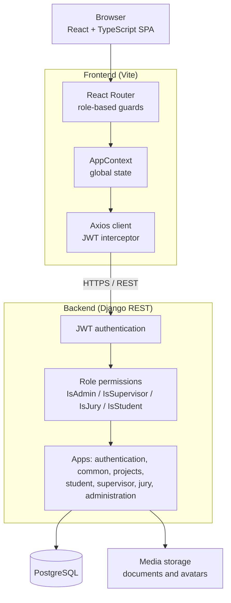

---

## Data Model

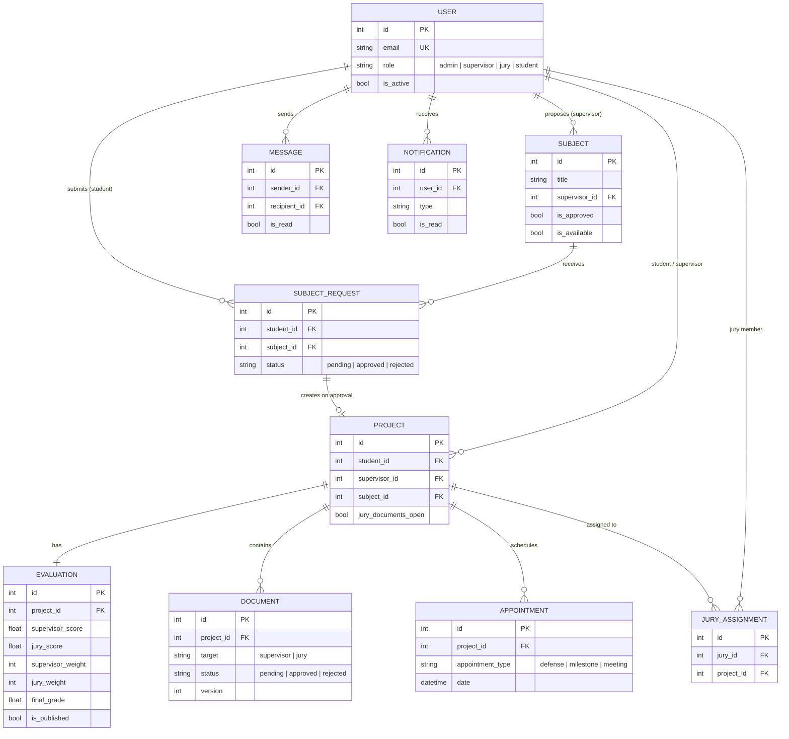

---

## Business Flows

### Topic selection

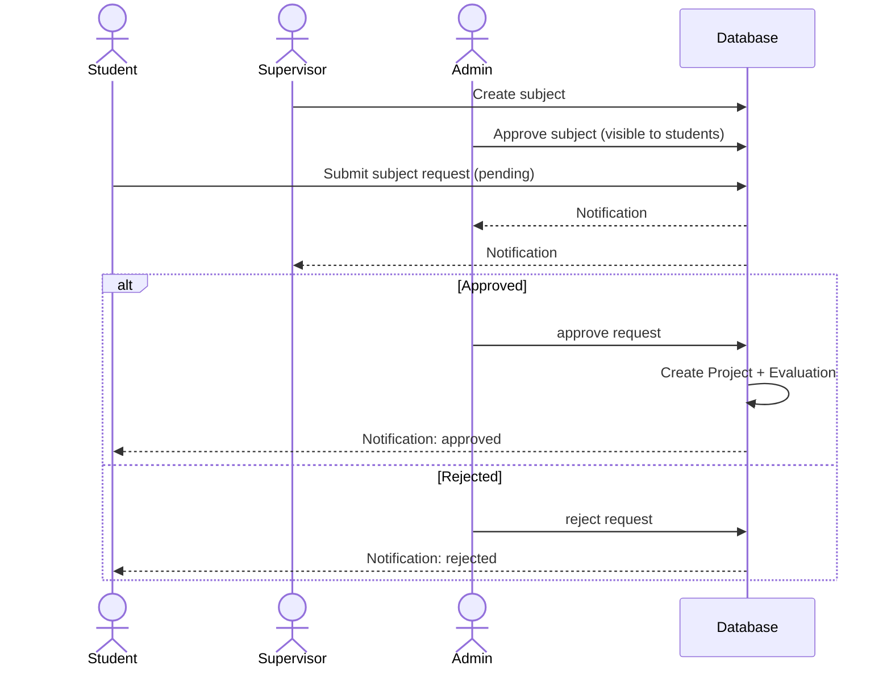

### Document lifecycle

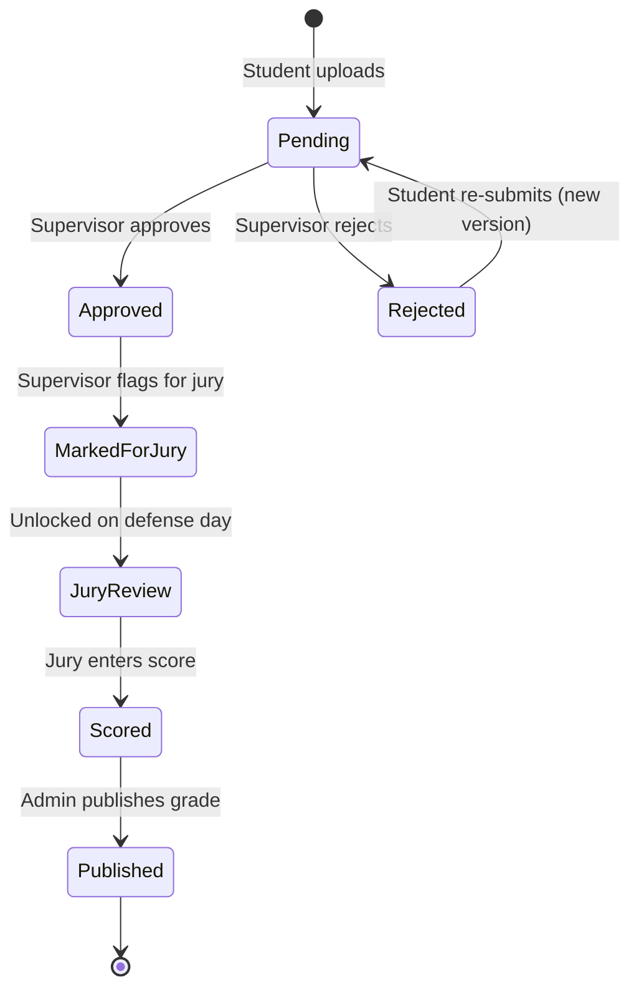

### Final grade

```
FinalGrade = SupervisorScore × (SupervisorWeight / 100) + JuryScore × (JuryWeight / 100)
```

Publication is only allowed when `SupervisorWeight + JuryWeight = 100`. Default weighting is 50 / 50. The student is notified on publication.

---

## Project Structure

```
PFE-Navigator/
├── Backend/                      Django REST API
│   ├── apps/
│   │   ├── authentication/       Custom user model, JWT, permissions
│   │   ├── common/               Core models: Subject, Project, Document, Evaluation...
│   │   ├── projects/             Subject and project endpoints
│   │   ├── student/              Student endpoints
│   │   ├── supervisor/           Supervisor endpoints
│   │   ├── jury/                 Jury endpoints
│   │   └── administration/       Admin endpoints
│   ├── core/                     Settings, root URLs, WSGI/ASGI
│   ├── database/                 SQL schema, seed data, deploy helper
│   ├── seed_all.py               Demo accounts
│   └── requirements.txt
│
├── Frontend/                     React + TypeScript SPA
│   ├── src/
│   │   ├── pages/                Admin, Supervisor, Jury, Student, Auth, Common, Portal
│   │   ├── context/AppContext.tsx  Global state (session, projects, evaluations...)
│   │   ├── api/                  Axios client and endpoint modules
│   │   ├── components/           Shared UI components
│   │   ├── config/ · types/      Constants and TypeScript interfaces
│   │   ├── App.tsx               Shell and routes
│   │   └── main.tsx
│   └── vite.config.ts
│
└── docs/screenshots/             README images
```

---

## Getting Started

### Prerequisites

- Python 3.11+
- Node.js 18+
- PostgreSQL 14+ (optional: SQLite is used by default for local development)

### 1. Clone

```bash
git clone https://github.com/Lagmouchyoussef/PFE-Navigator.git
cd PFE-Navigator
```

### 2. Backend

```bash
cd Backend
python -m venv venv
source venv/bin/activate          # Windows: venv\Scripts\activate
pip install -r requirements.txt

# Create Backend/.env (see Configuration below)

python manage.py migrate
python seed_all.py                # demo accounts (see below)
python manage.py runserver        # http://localhost:8000
```

### 3. Frontend

```bash
cd Frontend
npm install
npm run dev                       # http://localhost:5173
```

The Vite dev server proxies API calls to the Django backend.

### Demo accounts

Created by `seed_all.py`. **For local development only, never use these in production.**

| Role | Email | Password |
|------|-------|----------|
| Administrator | `admin@emsi.ma` | `admin123` |
| Supervisor | `supervisor@emsi.ma` | `password123` |
| Jury | `jury@emsi.ma` | `password123` |
| Student | `student@emsi.ma` | `password123` |

### PostgreSQL (optional)

```sql
CREATE DATABASE recherche_db;
```

Then set `DB_ENGINE=postgresql` and the `DB_*` variables in `Backend/.env`.

---

## Configuration

`Backend/.env`:

```env
SECRET_KEY=change-me
DEBUG=True
ALLOWED_HOSTS=localhost,127.0.0.1
CORS_ALLOWED_ORIGINS=http://localhost:5173

# Database: "sqlite" (default) or "postgresql"
DB_ENGINE=sqlite
DB_NAME=recherche_db
DB_USER=postgres
DB_PASSWORD=
DB_HOST=127.0.0.1
DB_PORT=5432
```

---

## Authentication & Security

- JWT authentication with a short-lived **access token (2 h)** and a **refresh token (7 d)**.
- The Axios interceptor transparently refreshes an expired access token and retries the request; if the refresh token has expired, the user is logged out.
- Authorization is enforced **server-side** by role permissions (`IsAdmin`, `IsSupervisor`, `IsJury`, `IsStudent`); frontend route guards are only a UX layer.
- Tokens are kept in `sessionStorage` (`pfe_access_token`, `pfe_refresh_token`).

---

## API Reference

| Method | Endpoint | Role | Description |
|--------|----------|------|-------------|
| `POST` | `/api/auth/login/` | All | Log in, returns JWT pair |
| `POST` | `/api/auth/refresh/` | All | Renew access token |
| `GET` | `/api/auth/me/` | All | Current user |
| `GET` `POST` | `/api/projects/subjects/` | All / Supervisor | List or create topics |
| `POST` | `/api/projects/subject-requests/` | Student | Request a topic |
| `POST` | `/api/projects/subject-requests/{id}/{action}/` | Admin | Approve / reject a request |
| `GET` | `/api/projects/projects/` | All | List projects |
| `GET` `POST` | `/api/student/documents/` | Student | List / submit documents |
| `GET` | `/api/supervisor/dashboard/` | Supervisor | Supervisor dashboard data |
| `GET` `POST` | `/api/supervisor/evaluations/` | Supervisor | Score students |
| `GET` | `/api/jury/projects/` | Jury | Assigned projects |
| `GET` `POST` | `/api/jury/evaluations/` | Jury | Defense evaluations |
| `GET` | `/api/admin/stats/` · `/api/admin/analytics/` | Admin | Platform metrics |
| `GET` | `/api/admin/evaluations/` | Admin | Review and publish grades |
| `GET` | `/api/notifications/` | All | List notifications |
| `GET` `POST` | `/api/messages/` | All | Messaging |

Errors follow the DRF format, e.g. `{ "detail": "Authentication credentials were not provided." }`.

---

## Critical Areas of the Codebase

Changes here need extra care and manual testing.

| Area | Location | Why it matters |
|------|----------|----------------|
| `requestSubject()` | `Frontend/src/context/AppContext.tsx` | Drives project creation |
| `updateEvaluationByAdmin()`, `publishEvaluation()` | `AppContext.tsx` | Can corrupt or hide evaluation records |
| `Project.save()` override | `Backend/apps/common/models.py` | Auto-creates the linked `Evaluation` |
| `SupervisorSubjectViewSet.perform_create()` | `Backend/apps/supervisor/views.py` | Sets subject approval state |
| Final grade computation | `Frontend/src/pages/Admin/Grades` | Weighted grade formula |

---

## Author

**Youssef Lagmouch**: [GitHub](https://github.com/Lagmouchyoussef) · [yousseflagmouxch@gmail.com](mailto:yousseflagmouxch@gmail.com)

Final Year Project, EMSI 2025-2026.
