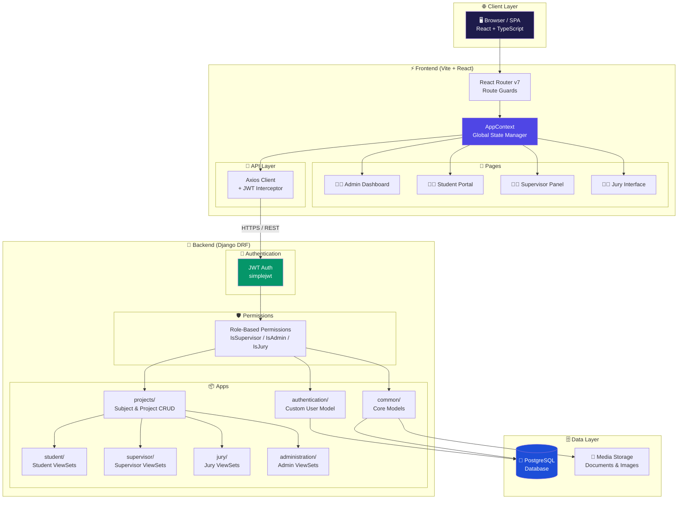
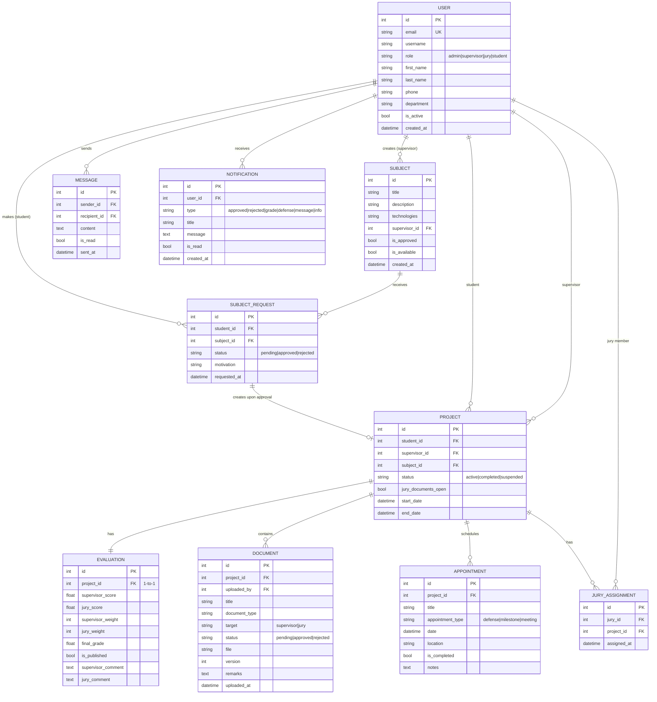
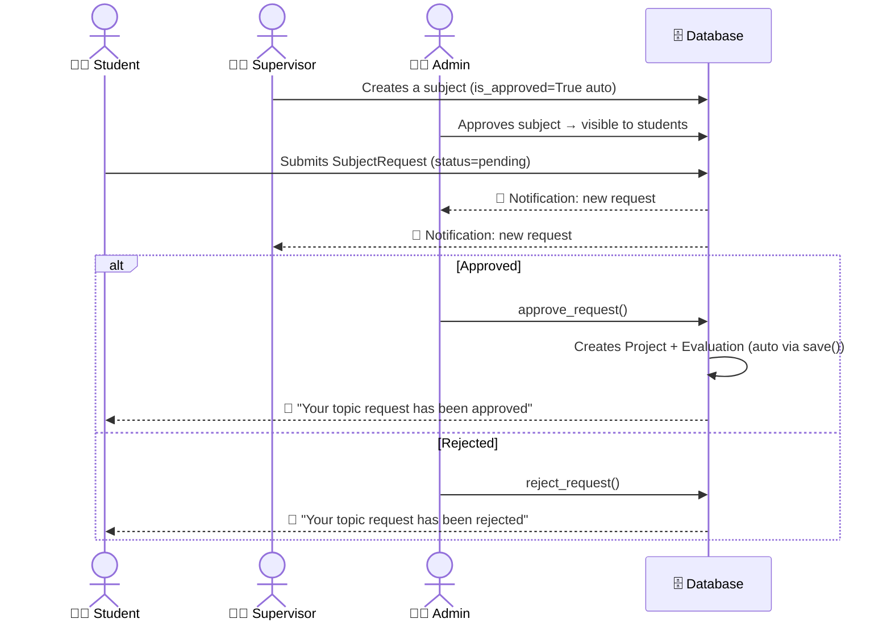
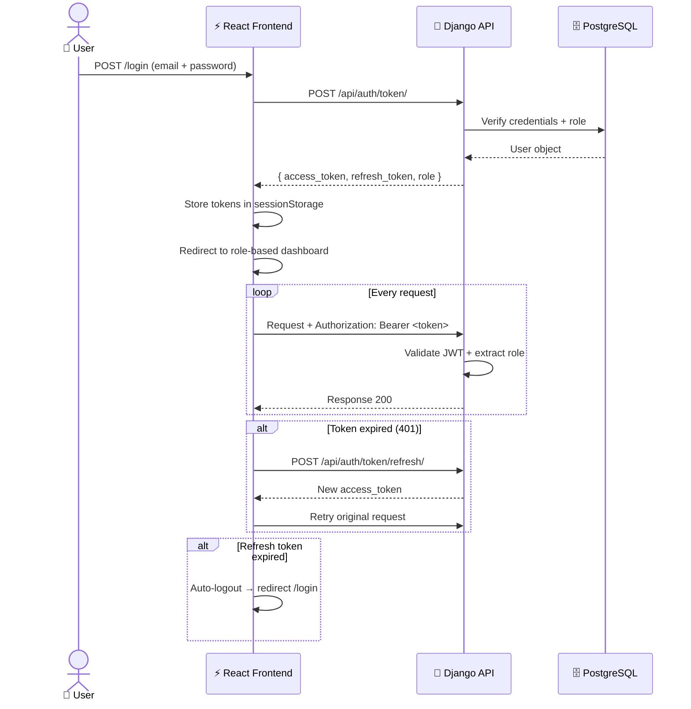
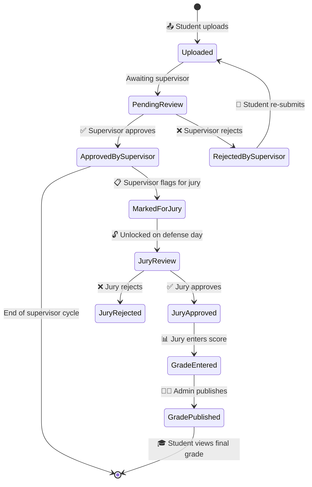
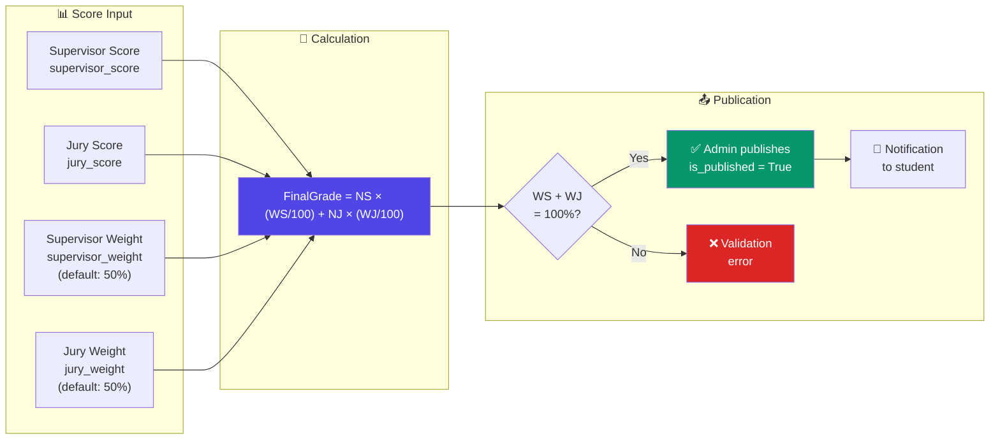
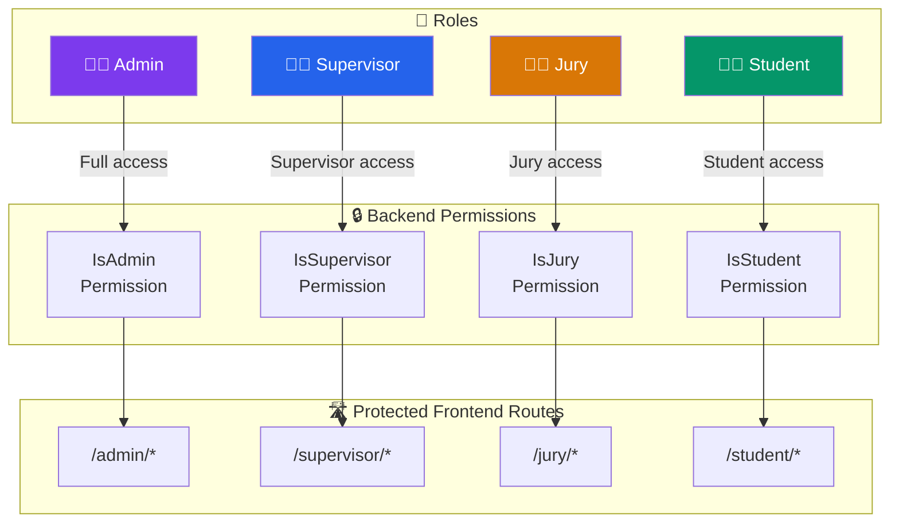
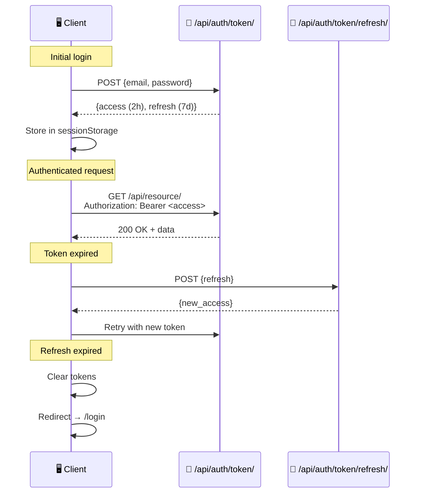
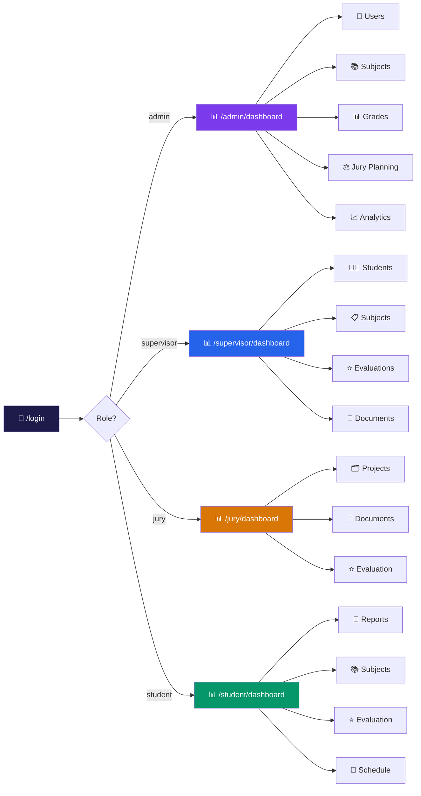

<div align="center">


<br/>

[](https://djangoproject.com)
[](https://react.dev)
[](https://typescriptlang.org)
[](https://postgresql.org)
[](https://python.org)
[](https://vitejs.dev)

<br/>

[](LICENSE)
[](CONTRIBUTING.md)
[](https://emsi.ma)
[]()

<br/>

> **A full-stack platform managing the entire lifecycle of Final Year Projects (PFE)**  
> From topic selection to grade publication — one system, four roles, zero paperwork.

</div>

---

## 📋 Table of Contents

- [🎯 Overview](#-overview)
- [✨ Features by Role](#-features-by-role)
- [🛠️ Tech Stack](#️-tech-stack)
- [🏗️ System Architecture](#️-system-architecture)
- [🗄️ Data Model](#️-data-model)
- [🔄 Key Business Flows](#-key-business-flows)
- [📂 Project Structure](#-project-structure)
- [🚀 Installation & Setup](#-installation--setup)
- [🔐 Authentication & Security](#-authentication--security)
- [📡 API Reference](#-api-reference)
- [🎨 User Interface](#-user-interface)
- [⚙️ Configuration](#️-configuration)

---

## 🎯 Overview

The **PFE Management Platform** is a full-stack web application built for **EMSI** that automates and centralizes the management of final year research projects. It covers the entire lifecycle:

```
Topic Creation  →  Student Selection  →  Tracking & Documents  →  Defense  →  Final Grades
```

| Actor | Role in the system |
|-------|--------------------|
| 👨‍💼 **Administrator** | Topic approval, jury assignment, grade publication, analytics |
| 👨‍🏫 **Supervisor** | Topic creation, student supervision, evaluation, milestone tracking |
| 👨‍⚖️ **Jury** | Project consultation, defense evaluation |
| 👨‍🎓 **Student** | Topic selection, document submission, progress tracking |

---

## ✨ Features by Role

<details>
<summary><b>👨‍💼 Administrator</b></summary>

- ✅ Global dashboard with metrics and charts (Recharts)
- ✅ Full user management (CRUD + enable/disable accounts)
- ✅ PFE topic validation and rejection
- ✅ Student subject-request approval
- ✅ Jury scheduling and project assignment
- ✅ Final grade calculation and publication (configurable weighting)
- ✅ Targeted notifications and announcements
- ✅ Analytics: submission rates, grade distribution, progression
</details>

<details>
<summary><b>👨‍🏫 Supervisor</b></summary>

- ✅ Create and edit PFE topics
- ✅ Track assigned students with milestone timelines
- ✅ Review and approve submitted documents
- ✅ Score and qualitatively evaluate students
- ✅ Direct communication with students (internal messaging)
- ✅ Flag documents for jury review
</details>

<details>
<summary><b>👨‍⚖️ Jury</b></summary>

- ✅ Access to assigned projects
- ✅ View defense documents (auto-unlocked on defense day)
- ✅ Enter defense scores with detailed criteria
- ✅ Consult results after publication
</details>

<details>
<summary><b>👨‍🎓 Student</b></summary>

- ✅ Browse available topics and submit requests
- ✅ Upload reports and deliverables (versioning)
- ✅ Real-time progress and milestone tracking
- ✅ View evaluations and supervisor remarks
- ✅ Defense schedule with automatic notifications
- ✅ Messaging with supervisor
</details>

---

## 🛠️ Tech Stack

<div align="center">

### Backend
[](https://skillicons.dev)

### Frontend
[](https://skillicons.dev)

</div>

| Layer | Technology | Version | Purpose |
|-------|------------|---------|---------|
| **Backend Framework** | Django + DRF | 5.2.1 / 3.15.2 | REST API, business logic |
| **Authentication** | Django Simple JWT | 5.4.0 | JWT tokens (access 2h, refresh 7d) |
| **Database** | PostgreSQL | Latest | Primary persistence |
| **Frontend Framework** | React | 19.2.6 | SPA interface |
| **Language** | TypeScript | 5.x | Static typing on the frontend |
| **Build Tool** | Vite | 8.0.10 | HMR, optimized bundling |
| **UI Components** | React Bootstrap | 2.10.10 | Responsive components |
| **Animations** | Framer Motion | 12.38.0 | Smooth page transitions |
| **Charts** | Recharts | 3.8.1 | Analytics & visualizations |
| **HTTP Client** | Axios | 1.16.1 | API calls with auto-refresh interceptor |
| **Icons** | Lucide React | Latest | Consistent icon set |
| **CORS** | django-cors-headers | Latest | Cross-origin requests |

---

## 🏗️ System Architecture



---

## 🗄️ Data Model



---

## 🔄 Key Business Flows

### 1. Topic Selection Flow



### 2. JWT Authentication Flow



### 3. Document & Evaluation Workflow



### 4. Final Grade Calculation



### 5. Role-Based Access Control



---

## 📂 Project Structure

```
📁 Projet Recherche Scientifique/
│
├── 📁 Backend/                          # Django REST API
│   ├── 📁 apps/
│   │   ├── 📁 authentication/           # Custom User model + JWT views
│   │   │   ├── models.py                # CustomUser with role field
│   │   │   ├── serializers.py           # UserSerializer, TokenSerializer
│   │   │   └── views.py                 # Login, Register, Profile
│   │   │
│   │   ├── 📁 common/                   # Shared models (core of the system)
│   │   │   ├── models.py                # Subject, Project, Document, Evaluation...
│   │   │   ├── serializers.py           # Common serializers
│   │   │   └── admin.py                 # Django Admin interface
│   │   │
│   │   ├── 📁 projects/                 # Project & subject ViewSets
│   │   ├── 📁 student/                  # Student-specific endpoints
│   │   ├── 📁 supervisor/               # Supervisor endpoints
│   │   ├── 📁 jury/                     # Jury endpoints
│   │   └── 📁 administration/           # Admin endpoints
│   │
│   ├── 📁 core/
│   │   ├── settings.py                  # Django config (DB, JWT, CORS)
│   │   ├── urls.py                      # Main API routing
│   │   └── wsgi.py / asgi.py
│   │
│   ├── requirements.txt                 # Python dependencies
│   └── manage.py                        # Django CLI
│
└── 📁 Frontend/                         # React + TypeScript SPA
    ├── 📁 src/
    │   ├── 📁 pages/
    │   │   ├── 📁 Admin/                # Dashboard, Users, Grades, Analytics
    │   │   │   ├── Dashboard/
    │   │   │   ├── Users/
    │   │   │   ├── Grades/              # computeFinal() → weighted grade
    │   │   │   ├── Subjects/
    │   │   │   ├── JuryPlanning/
    │   │   │   └── Analytics/
    │   │   │
    │   │   ├── 📁 Student/              # Dashboard, Reports, Subjects
    │   │   ├── 📁 Supervisor/           # Students, Evaluations, Documents
    │   │   ├── 📁 Jury/                 # Projects, Documents, Evaluation
    │   │   └── 📁 Auth/                 # Login (student & admin)
    │   │
    │   ├── 📁 context/
    │   │   └── AppContext.tsx            # ⭐ Global state (1038 lines)
    │   │                                #    Session, Projects, Documents,
    │   │                                #    Evaluations, Messages, Notifications
    │   │
    │   ├── 📁 api/
    │   │   ├── client.ts                # Axios + auto-refresh JWT interceptor
    │   │   ├── projects.ts              # CRUD projects, subjects, documents
    │   │   ├── users.ts                 # CRUD users
    │   │   ├── auth.ts                  # Login, logout, refresh
    │   │   └── communications.ts        # Messages & notifications
    │   │
    │   ├── 📁 types/                    # TypeScript interfaces
    │   ├── 📁 config/                   # Constants & endpoints
    │   ├── 📁 components/               # SidebarLink, NotificationItem, ErrorBoundary
    │   ├── App.tsx                      # Shell: Header + Sidebar + Routes (578 lines)
    │   └── main.tsx                     # React entry point
    │
    ├── package.json                     # Node dependencies
    └── vite.config.ts                   # Vite config + API proxy
```

---

## 🚀 Installation & Setup

### Prerequisites

```bash
Python >= 3.11
Node.js >= 18
PostgreSQL >= 14
```

### 1. Clone the repository

```bash
git clone https://github.com/your-username/pfe-management-platform.git
cd pfe-management-platform
```

### 2. Backend (Django)

```bash
cd Backend

# Create virtual environment
python -m venv venv
source venv/bin/activate          # Linux/Mac
# or: venv\Scripts\activate       # Windows

# Install dependencies
pip install -r requirements.txt

# Set up environment variables
cp .env.example .env
# Edit .env:
#   DB_NAME=pfe_db
#   DB_USER=postgres
#   DB_PASSWORD=your_password
#   DB_HOST=localhost
#   DB_PORT=5432
#   SECRET_KEY=your-secret-key
#   DEBUG=True

# Apply migrations
python manage.py migrate

# Create admin superuser
python manage.py createsuperuser

# Start the server
python manage.py runserver
# API available at http://localhost:8000/api/
```

### 3. Frontend (React)

```bash
cd Frontend

# Install dependencies
npm install

# API is pre-proxied via vite.config.ts
# Default target: http://localhost:8000

# Start development server
npm run dev
# App available at http://localhost:5173

# Production build
npm run build
```

### 4. PostgreSQL Database

```sql
CREATE DATABASE pfe_db;
CREATE USER pfe_user WITH PASSWORD 'your_password';
GRANT ALL PRIVILEGES ON DATABASE pfe_db TO pfe_user;
```

---

## 🔐 Authentication & Security



| Token | Lifetime | Storage | Usage |
|-------|----------|---------|-------|
| `access_token` | 2 hours | `sessionStorage` | Every API request |
| `refresh_token` | 7 days | `sessionStorage` | Silent token renewal |

**Storage keys:** `pfe_access_token`, `pfe_refresh_token`

---

## 📡 API Reference

### Main Endpoints

| Method | Endpoint | Role | Description |
|--------|----------|------|-------------|
| `POST` | `/api/auth/token/` | All | Login → JWT tokens |
| `POST` | `/api/auth/token/refresh/` | All | Renew access token |
| `GET` | `/api/projects/subjects/` | All | List available topics |
| `POST` | `/api/projects/subjects/` | Supervisor | Create a topic |
| `POST` | `/api/projects/subject-requests/` | Student | Request a topic |
| `PATCH` | `/api/administration/subject-requests/{id}/` | Admin | Approve / reject |
| `GET` | `/api/projects/projects/` | All | List projects |
| `POST` | `/api/common/documents/` | Student | Submit a document |
| `PATCH` | `/api/supervisor/documents/{id}/` | Supervisor | Review a document |
| `GET` | `/api/jury/evaluations/` | Jury | View evaluations |
| `POST` | `/api/administration/grades/publish/` | Admin | Publish grades |
| `GET` | `/api/common/notifications/` | All | User notifications |
| `POST` | `/api/common/messages/` | All | Send a message |

### Response Format

```json
// Success
{
  "id": 1,
  "title": "ML Recommendation System",
  "status": "active",
  "supervisor": { "id": 5, "name": "Dr. Alami" },
  "student": { "id": 12, "name": "Youssef L." }
}

// Error
{
  "detail": "Authentication credentials were not provided.",
  "status_code": 401
}
```

---

## 🎨 User Interface

### Cross-Cutting Features

| Feature | Implementation |
|---------|---------------|
| 🌙 **Theme** | Light / Dark / System (CSS variables) |
| 📱 **Responsive** | React Bootstrap grid + collapsible sidebar |
| 🔔 **Notifications** | Real-time badge in header, dropdown panel |
| 💬 **Messaging** | Unread counter, message dropdown |
| ✨ **Animations** | Framer Motion page transitions |
| 📊 **Charts** | Recharts for admin analytics |

### Sidebar Navigation Map



---

## ⚙️ Configuration

### Backend Environment Variables (`.env`)

```env
# Django
SECRET_KEY=your-very-secret-key-here
DEBUG=True
ALLOWED_HOSTS=localhost,127.0.0.1

# PostgreSQL
DB_NAME=pfe_db
DB_USER=postgres
DB_PASSWORD=your_password
DB_HOST=localhost
DB_PORT=5432

# JWT Tokens
JWT_ACCESS_TOKEN_LIFETIME_HOURS=2
JWT_REFRESH_TOKEN_LIFETIME_DAYS=7

# CORS
CORS_ALLOWED_ORIGINS=http://localhost:5173,http://localhost:3000
```

### Vite API Proxy

```typescript
// vite.config.ts
export default defineConfig({
  plugins: [react()],
  server: {
    proxy: {
      '/api': {
        target: 'http://localhost:8000',
        changeOrigin: true,
      }
    }
  }
})
```

---

## ⚠️ Critical Functions

> These functions are at the heart of the system. Any modification must be done with extreme care.

| Function | File | Risk |
|----------|------|------|
| `AppContext.requestSubject(id)` | `AppContext.tsx` | 🔴 Breaking this blocks project creation entirely |
| `AppContext.updateEvaluationByAdmin()` | `AppContext.tsx` | 🔴 Can corrupt evaluation records |
| `AppContext.publishEvaluation(id)` | `AppContext.tsx` | 🔴 Misconfiguration hides grades from students |
| `Project.save()` override | `common/models.py` | 🔴 Auto-creates Evaluation — do not remove |
| `SupervisorSubjectViewSet.perform_create()` | `supervisor/views.py` | 🟡 Forces `is_approved=True` directly |
| `AdminGrades.computeFinal()` | `AdminGrades.jsx` | 🔴 Math errors produce invalid final grades |

---

<div align="center">

---

**Built with ❤️ for EMSI**

[](https://github.com/Lagmouchyoussef)
[](mailto:yousseflagmouxch@gmail.com)

*Final Year Project — EMSI 2025-2026*

</div>
